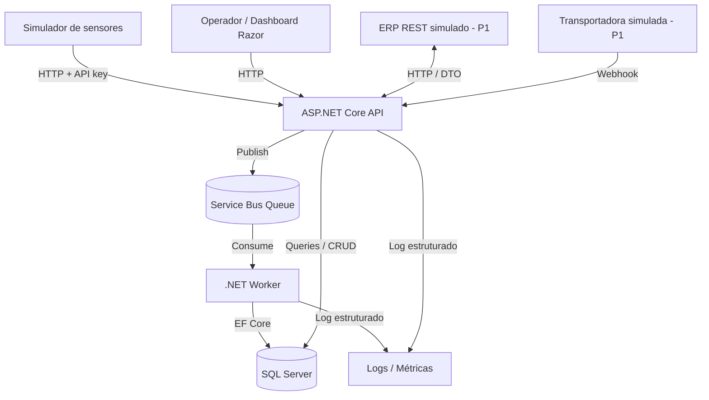

# CargoPulse — Especificação funcional e técnica

- **Versão:** 1.2
- **Data de referência:** 05/11/2026
- **Estado:** especificação em planejamento; implementação não iniciada.
- **Domínio:** telemetria de cargas sensíveis à temperatura e integração logística.

Este documento descreve o escopo, os contratos e os critérios técnicos previstos para o CargoPulse. As seções 20 e 21 estabelecem critérios de entrega e validação; as definições pendentes estão na seção 23.

---

## 1. Visão geral

CargoPulse é uma plataforma de telemetria e integração logística para cargas sensíveis à temperatura. O fluxo previsto recebe medições de sensores simulados, processa eventos de forma assíncrona, preserva o histórico e gera alertas de temperatura. Integrações com sistemas externos simulados compõem uma etapa posterior.

### 1.1 Contexto operacional

Dados de transporte podem chegar duplicados, atrasados, inválidos ou durante períodos de indisponibilidade. A operação necessita de histórico consistente, identificação das últimas medições válidas, detecção de desvios de temperatura e rastreabilidade de falhas de processamento e integração.

### 1.2 Objetivo técnico

O sistema reúne ingestão HTTP, persistência relacional, mensageria, processamento idempotente e integração de contratos externos em uma aplicação local reproduzível.

### 1.3 Perfis de uso

- Operação logística: cadastro de dispositivos, veículos e entregas; consulta de medições e alertas.
- Desenvolvimento e validação: geração de eventos determinísticos, reprodução de falhas e reconciliação dos resultados.

### 1.4 Critérios de validação

- Execução local reproduzível a partir das instruções do README.
- Fluxo completo: simulador → API → fila → Worker → SQL Server → dashboard.
- Comportamento de duplicatas, ordenação temporal e falhas transitórias verificado por testes.
- Fronteiras explícitas entre domínio, casos de uso e infraestrutura.
- Resultados de teste e desempenho acompanhados das condições de execução.

---

## 2. Limites e estratégia de entrega

### 2.1 Prioridades

| Prioridade | Abrangência | Resultado |
|---|---|---|
| P0 — MVP | Cadastro, ingestão, fila, Worker, histórico, alertas, dashboard mínimo, testes e execução local | Fluxo local completo e reproduzível |
| P1 — Integrações | ERP REST simulado, webhooks de transportadoras, erros e reprocessamento | Sincronização e reprocessamento de integrações |
| P2 — Diferenciais | SOAP/XML, cache, Azure Functions, observabilidade ampliada, testes de carga avançados | Extensões opcionais após o MVP |

### 2.2 Fora do escopo do MVP

- Dispositivos físicos reais, firmware, modem GPS e protocolos industriais proprietários.
- Mapas comerciais ou rastreamento em tempo real de alta frequência.
- Microserviços distribuídos, Kubernetes, multi-tenant, faturamento, assinatura e aplicativo móvel.
- Machine learning, previsão de falha e análises avançadas.
- Hospedagem de produção; cloud paga não é requisito.
- Garantias de produção do emulador de Service Bus.

### 2.3 Princípio de execução

A entrega inicial percorre o fluxo completo com uma medição e um teste automatizado. Lotes, cenários adicionais de falha e interface são incorporados em incrementos posteriores. P1/P2 dependem de P0 funcional e reproduzível.

---

## 3. Cenário de negócio

Uma transportadora fictícia transporta medicamentos refrigerados. Cada **Entrega** possui uma janela de operação, uma faixa permitida de temperatura, um veículo e um dispositivo sensor associado. O dispositivo emite leituras de temperatura, umidade e localização com um identificador próprio de evento.

**Fluxo principal:**

1. Um operador cadastra um dispositivo, um veículo e uma entrega com faixa aceitável de temperatura.
2. Associa o dispositivo à entrega durante a viagem.
3. O simulador produz medições com `deviceId`, `eventId`, `occurredAtUtc`, temperatura, umidade e coordenadas opcionais.
4. A API autentica a origem, valida o contrato e publica mensagem na fila.
5. O Worker recebe a mensagem, valida as regras dependentes do banco, grava a leitura e atualiza projeções.
6. Se a temperatura estiver fora da faixa, gera um alerta associado à leitura.
7. O dashboard permite consultar histórico e alertas.
8. Na fase P1, uma integração externa importa pedidos e recebe atualizações do estado da entrega.

Os dados da aplicação e dos testes são sintéticos. Identificadores de frota e localização representam cenários fictícios, sem dados de clientes ou pessoas reais.

---

## 4. Capacidades técnicas

| Área | Aplicação prevista |
|---|---|
| C# / .NET | Domínio, API, Worker e simulador |
| ASP.NET Core / REST | Endpoints versionados, validação e documentação OpenAPI |
| SQL Server / EF Core | Modelo relacional, migrations, índices e consultas paginadas |
| Mensageria | Fila do Azure Service Bus e consumidor idempotente |
| Telemetria | Ingestão individual e em lote, eventos atrasados e duplicados |
| Integração ERP (P1) | Adaptador REST simulado, DTOs, transformação e tratamento de erros |
| Webhooks (P1) | Autenticação de origem, idempotência e ordenação de eventos |
| Qualidade | Testes unitários, integração, CI e logs estruturados |
| Interface operacional | MVC/Razor com consultas de histórico e alertas |

---

## 5. Stack técnica

| Camada | Escolha inicial | Justificativa |
|---|---|---|
| Linguagem e runtime | **C# / .NET 10 LTS** | Plataforma moderna, suporte de longo prazo |
| API / UI | **ASP.NET Core Web API + MVC/Razor** | Backend + demonstração web com pouca complexidade extra |
| Persistência | **SQL Server + EF Core** | Modelo relacional e migrations reproduzíveis |
| Fila | **Azure Service Bus**, emulador local | Contratos e SDK de mensageria relevantes para telemetria |
| Consumidor | **.NET Worker Service** | Processamento assíncrono separado da API |
| Testes | **xUnit + WebApplicationFactory + SQL real em testes de integração** | Evitar testes que mascaram diferenças de SQL |
| Ambiente | **Docker Compose** + .NET SDK | Windows e Linux, sem serviços pagos |
| CI | **GitHub Actions** | Build, análise estática e testes |
| Documentação | Markdown + OpenAPI | Referência técnica e descrição dos contratos |

**Observações de viabilidade:**

- O emulador do Azure Service Bus é restrito a desenvolvimento e testes. Mensagens e entidades não são preservadas após reinício; suas características operacionais diferem do serviço em nuvem.
- A execução do SQL Server em container Linux depende dos requisitos de plataforma e das condições de licença da versão utilizada.
- Dependências e imagens utilizam versões fixadas e registradas no README para reprodução do ambiente.
- A execução do MVP utiliza recursos locais, sem dependência de serviços Azure pagos.

Documentação oficial de referência:

- [.NET — versões e suporte](https://learn.microsoft.com/pt-br/dotnet/core/releases-and-support)
- [Azure Service Bus Emulator — visão geral](https://learn.microsoft.com/en-us/azure/service-bus-messaging/overview-emulator)
- [Azure Service Bus Emulator — execução local](https://learn.microsoft.com/en-us/azure/service-bus-messaging/test-locally-with-service-bus-emulator)
- [SQL Server no Docker](https://learn.microsoft.com/en-us/sql/linux/quickstart-install-connect-docker?view=sql-server-ver17)
- [Testes de integração ASP.NET Core](https://learn.microsoft.com/en-us/aspnet/core/test/integration-tests?view=aspnetcore-10.0)

---

## 6. Arquitetura

### 6.1 Diagrama lógico



No MVP, o dashboard compartilha o host ASP.NET Core com a API. Regras de negócio permanecem fora de controllers e views.

### 6.2 Responsabilidades

- `CargoPulse.Domain`: entidades, invariantes, enums e decisões puras de negócio; **sem referências** a EF Core, ASP.NET, Service Bus ou infraestrutura.
- `CargoPulse.Application`: casos de uso, portas/interfaces, DTOs internos, validação de aplicação e orquestração; **sem lógica concreta** de banco ou HTTP externo.
- `CargoPulse.Infrastructure`: DbContext, migrations, repositórios/queries, cliente de Service Bus, integração externa e observabilidade.
- `CargoPulse.Api`: controllers/endpoints, autenticação, contratos HTTP, mapeamento, tratamento de erros e views Razor.
- `CargoPulse.Worker`: `BackgroundService`, consumo de mensagens, política de retry, transações e confirmação.
- `CargoPulse.Simulator`: CLI/console para gerar eventos determinísticos e cenários de falha; não depende de hardware.

### 6.3 Regras de arquitetura

1. `Domain` não conhece `Application`, `Infrastructure`, `Api` ou `Worker`.
2. `Application` pode depender de `Domain`; define abstrações necessárias.
3. `Infrastructure` implementa abstrações, não decide regras essenciais de negócio.
4. `Api`, `Worker` e `Simulator` não implementam regras duplicadas de domínio.
5. Operações HTTP não devem conter consultas EF diretamente em controllers.
6. Interfaces e repositórios atendem a usos concretos. A adoção de CQRS/event sourcing ou bibliotecas adicionais depende de benefício demonstrável.
7. Mensagens e endpoints são contratos versionados.
8. Padrões e abstrações atendem a problemas identificados e verificáveis.

O detalhamento de modularidade, SOLID (incluindo open/closed), reutilização de regras e resiliência depende da consolidação de requisitos da seção 23.1. Circuit breaker permanece sujeito à identificação da dependência afetada, dos critérios de abertura e da condição de recuperação.

### 6.4 Entrega sem perda silenciosa

No MVP, a API retorna **202 Accepted somente depois que o broker confirma o aceite da mensagem**. Se o publish falhar, retorna erro apropriado, registra correlação e permite ao cliente repetir com o mesmo `eventId`.

O consumidor assume entrega **at-least-once** e aplica **idempotência no SQL**. O emulador local não oferece garantia de durabilidade fim a fim; a arquitetura não estabelece entrega exactly-once.

Um *transactional outbox* para sincronização de mutação SQL e publicação de eventos derivados é uma alternativa P2, condicionada à necessidade de consistência entre as duas operações. A ausência desse mecanismo mantém o risco de dual-write nos fluxos que combinarem ambas.

---

## 7. Modelo de domínio

### 7.1 Entidades P0

| Entidade | Campos essenciais | Regra relevante |
|---|---|---|
| `Device` | `Id`, `ExternalCode`, `Name`, `IsActive`, `CreatedAtUtc` | Código externo único; inativo não aceita novas leituras |
| `Vehicle` | `Id`, `FleetCode`, `Description` | Código de frota único (fictício) |
| `Shipment` | `Id`, `ExternalReference`, `VehicleId`, `Status`, `MinTempC`, `MaxTempC`, `StartedAtUtc`, `FinishedAtUtc?` | `MinTempC < MaxTempC`; status tem transições válidas |
| `DeviceAssignment` | `Id`, `DeviceId`, `ShipmentId`, `ValidFromUtc`, `ValidToUtc?` | Um dispositivo tem no máximo uma associação ativa em um instante |
| `TelemetryReading` | `Id`, `DeviceId`, `EventId`, `OccurredAtUtc`, `ReceivedAtUtc`, `TemperatureC`, `HumidityPercent?`, `Latitude?`, `Longitude?`, `ShipmentId?`, `PayloadHash` | Chave única `(DeviceId, EventId)` |
| `TemperatureAlert` | `Id`, `ReadingId`, `ShipmentId`, `Type`, `ObservedTempC`, `CreatedAtUtc`, `AcknowledgedAtUtc?` | No máximo um alerta do mesmo tipo por leitura |
| `ProcessingFailure` | `Id`, `CorrelationId`, `DeviceId?`, `EventId?`, `Category`, `Reason`, `DetectedAtUtc`, `ResolutionStatus` | Rastrear falhas definitivas sem dados sensíveis |

### 7.2 Entidades P1

- `ExternalSystem`: origem/destino de integração, habilitação e configuração **sem segredos em banco de demonstração**.
- `ExternalMapping`: relação entre códigos externos e entidades internas.
- `IntegrationAttempt`: destino, operação, status, tentativas, último HTTP status, correlação.
- `CarrierTrackingEvent`: identificador do evento, transportadora, estado, `occurredAtUtc`, payload normalizado.

### 7.3 Regras de negócio

**RB-01 — Unicidade.** Uma medição é identificada por `(deviceId, eventId)`. Uma retransmissão com os mesmos campos e conteúdo não cria nova linha. Um mesmo identificador com conteúdo conflitante é rejeitado/quarentenado como inconsistência.

**RB-02 — Tempo de evento ≠ tempo de recepção.** `occurredAtUtc` indica quando a medição foi tomada; `receivedAtUtc` indica quando foi recebida. Não substituir o primeiro pelo segundo.

**RB-03 — Mensagens atrasadas.** Uma leitura atrasada **entra no histórico**, mas não sobrescreve a visão de “última leitura por tempo de evento”. Empates de `occurredAtUtc` usam `EventId` como critério estável documentado, ou outro desempate determinístico escolhido em ADR.

**RB-04 — Associação temporal.** Uma leitura é associada à entrega ativa para aquele dispositivo **no instante `occurredAtUtc`**, não simplesmente à entrega ativa no momento do processamento. Se não houver associação, persistir leitura sem entrega e sinalizar para análise; não atribuir incorretamente.

**RB-05 — Alerta.** Temperatura `TemperatureC < MinTempC` ou `TemperatureC > MaxTempC` gera alerta. Limites inclusivos são permitidos. O alerta se vincula à leitura para não duplicar em reprocessamentos.

**RB-06 — Unidades e validação.** Temperatura em °C, umidade entre 0 e 100%, latitude entre -90 e 90, longitude entre -180 e 180; coordenadas devem vir ambas ou nenhuma. Definir limites plausíveis configuráveis de sensor sem excluir valores extremos legítimos de teste.

**RB-07 — Datas.** Todos timestamps armazenados e transmitidos em UTC; exemplos usam `Z`. A interface pode converter para timezone local explicitamente.

**RB-08 — Retentativa.** Falhas transitórias (timeout, indisponibilidade de DB) podem ser repetidas com atraso/backoff e limite. Dados inválidos/conflitantes não devem gerar loop infinito.

**RB-09 — Mensagens difíceis.** Após esgotar tentativas, enviar para DLQ quando disponível e registrar o diagnóstico. Não executar `Complete` antes de confirmar a transação SQL.

**RB-10 — Estado da entrega.** Exemplo: `Created -> InTransit -> Delivered` ou `Cancelled` conforme transições explícitas; não retroceder estados por webhook antigo.

**RB-11 — Segredos e logs.** Não salvar API keys, connection strings, tokens ou PII em logs, commits, fixtures públicas ou exemplos reais.

---

## 8. Contratos de eventos

### 8.1 TelemetryReceived V1 — payload público de ingestão

```json
{
  "eventId": "e1f2b2e7-c23a-41cb-8acc-d54f1d12ec6a",
  "deviceId": "d22db4c2-a0dd-4fd4-af9e-9c5a999a0e17",
  "occurredAtUtc": "2026-11-05T14:30:00Z",
  "temperatureC": 7.2,
  "humidityPercent": 62.0,
  "latitude": -23.3103,
  "longitude": -51.1628
}
```

**Contrato:**

- `eventId`, `deviceId`, `occurredAtUtc` e `temperatureC` são obrigatórios.
- Os IDs são UUIDs válidos; `eventId` é estável entre retentativas.
- `humidityPercent`, `latitude`, `longitude` são opcionais segundo RB-06.
- `temperatureC` é número decimal, não string.
- JSON inválido, campos obrigatórios ausentes e timestamps malformados resultam em `400` com `ProblemDetails`, sem exposição de segredos.
- A mensagem na fila identifica versão do contrato, `eventId` e `correlationId`; seu conteúdo é composto pelo payload validado e metadados, sem entidades EF.

### 8.2 Lotes

Endpoint de lote recebe `{ "items": [ ... ] }` com limite configurado, inicialmente **máximo de 1000 itens por request**. Há aceites/rejeições **por item**, com resultado que distingue `accepted`, `invalid` e `publishFailed`. Esse limite é um alvo de projeto, não benchmark de throughput.

A publicação parcial distingue o resultado de cada item. Um lote pode conter, por exemplo, 997 aceites, 2 rejeições por validação e 1 falha de broker. O cliente pode repetir os itens com os mesmos `eventId`. Uma resposta global `202` não representa aceite integral quando houver falhas. `200 OK` com relatório por item é uma alternativa para lotes parciais; a escolha final dos códigos HTTP permanece pendente e será refletida no OpenAPI.

---

## 9. API HTTP — contrato planejado

Base: `/api/v1`.

| Método | Rota | Finalidade | Prioridade |
|---|---|---|---|
| `GET` | `/health/live` | Liveness | P0 |
| `GET` | `/health/ready` | Readiness incluindo dependências necessárias | P0 |
| `POST` | `/devices` | Cadastrar dispositivo | P0 |
| `GET` | `/devices` | Listar com paginação | P0 |
| `GET` | `/devices/{id}` | Detalhar dispositivo | P0 |
| `POST` | `/vehicles` | Cadastrar veículo | P0 |
| `POST` | `/shipments` | Criar entrega | P0 |
| `GET` | `/shipments` | Listar entregas | P0 |
| `GET` | `/shipments/{id}` | Detalhar entrega | P0 |
| `POST` | `/shipments/{id}/assignments` | Associar dispositivo com intervalo | P0 |
| `POST` | `/telemetry` | Receber uma medição | P0 |
| `POST` | `/telemetry/batches` | Receber lote e retornar relatório por item | P0 |
| `GET` | `/devices/{id}/readings` | Consultar histórico paginado e ordenado | P0 |
| `GET` | `/shipments/{id}/latest-reading` | Última medição por tempo do evento | P0 |
| `GET` | `/shipments/{id}/alerts` | Consultar alertas | P0 |
| `POST` | `/alerts/{id}/acknowledge` | Reconhecer alerta | P0 |
| `POST` | `/integrations/erp/sync` | Importação manual de ERP simulado | P1 |
| `POST` | `/webhooks/carriers/{carrier}` | Receber evento de rastreio | P1 |
| `GET` | `/integrations/attempts` | Ver erros e estado de envio | P1 |
| `POST` | `/integrations/attempts/{id}/retry` | Reprocessar erro tratável | P1 |

### 9.1 Padrões HTTP

- `201 Created` para recurso criado; `202 Accepted` para mensagem individual **confirmada na fila**, ainda não persistida no histórico.
- `400 Bad Request` para contrato inválido, `401/403` para autenticação/autorização, `404` para inexistência, `409` para conflito detectável no ponto de entrada, `429` quando houver limitação; `503` ou erro de dependência para indisponibilidade do broker.
- `ProblemDetails` para erros; `correlationId` para suporte, sem stack trace em resposta pública.
- Paginação limitada por `pageSize`, ordem estável (`occurredAtUtc`, `eventId`) e filtros `fromUtc`, `toUtc`.
- OpenAPI deve refletir comportamento de processamento **eventual**: receber `202` não significa que o Worker já persistiu a medição.

---

## 10. Persistência e consultas

### 10.1 Restrições/indexação obrigatórias

- `Device.ExternalCode` unique.
- `Vehicle.FleetCode` unique.
- `Shipment.ExternalReference` unique.
- `TelemetryReading (DeviceId, EventId)` unique (proteção idempotente concorrente no banco).
- `TelemetryReading (DeviceId, OccurredAtUtc DESC, EventId)` para histórico/última medição.
- `TelemetryReading (ShipmentId, OccurredAtUtc DESC, EventId)` para consultas por entrega.
- `TemperatureAlert (ReadingId, Type)` unique.
- `DeviceAssignment` indexado por `(DeviceId, ValidFromUtc, ValidToUtc)`, com prevenção de sobreposição de períodos na lógica transacional.

### 10.2 Decisões de persistência

- Migrations EF Core versionadas, com aplicação controlada.
- Conversões de UTC/decimal explicitamente definidas; valores de medição devem manter precisão coerente.
- Paginação e filtros executados no SQL, não em coleção carregada inteiramente em memória.
- Testes de unicidade/constraints devem atingir SQL Server de fato; `EF Core InMemory` não substitui esses testes.
- Transação de gravação de leitura + alerta onde necessário; ao receber duplicata, consultar estado e fazer ACK sem refazer efeitos colaterais.

---

## 11. Worker, falhas e observabilidade

### 11.1 Algoritmo de processamento por mensagem

1. Ler envelope da fila e validar versão.
2. Propagar `correlationId` nos logs.
3. Validar formato e existência/estado do dispositivo.
4. Resolver `DeviceAssignment` pelo instante `occurredAtUtc`.
5. Calcular hash canônico do payload de negócio para detectar conflito de chave.
6. Abrir transação para inserir medição e possível alerta, respeitando unique constraints.
7. Commit da transação SQL.
8. Confirmar (`Complete`) a mensagem somente após sucesso do banco.
9. Se duplicata idêntica, registrar deduplicação sem erro e confirmar.
10. Se dado irrecuperável ou limite de tentativas, registrar diagnóstico e encaminhar para DLQ/quarentena.

### 11.2 Política de retentativas

- Classificação das falhas em **transitórias** e **permanentes**.
- Limites de tentativas, tempo máximo de processamento e backoff com jitter quando aplicável; os valores permanecem pendentes na seção 23.1.
- Registro da tentativa, causa e identidade do evento, com controle do volume de logs e exclusão de dados sensíveis.
- Exceções de processamento associadas a diagnóstico e resultado explícito.
- Tratamento de cancelamento do host e perda de lock da mensagem, com semântica de recuperação ainda pendente.

### 11.3 Logs e medições mínimas

Logs estruturados com `timestamp`, `level`, `operation`, `deviceId`, `eventId`, `correlationId`, `elapsedMs`, `result`.

Métricas a exibir em desenvolvimento: `received`, `published`, `processed`, `duplicate`, `invalid`, `failed`, `alertCreated`, atraso entre `occurredAtUtc` e processamento; taxa e tempo medidos por um cenário reproduzível.

Resultados de desempenho incluem hardware, quantidade de mensagens, configuração, média, percentis e limitações do emulador utilizados na medição.

---

## 12. Autenticação e segurança

**MVP local:**

- Ingestão de telemetria autenticada por API key de demonstração configurada por variável de ambiente.
- Endpoints administrativos e interface limitados a loopback enquanto a autenticação local não estiver disponível. O mecanismo de demonstração não estabelece controles de produção.
- Webhooks P1 com chave compartilhada ou assinatura HMAC verificada sobre o corpo bruto, `timestamp` e proteção contra replay; segredos em variáveis de ambiente.
- TLS ao sair do localhost; o Docker de demonstração não exige certificado público.
- Limite de tamanho de requisição/lote; validação de entrada; tratamento de falhas sem expor stack trace.
- Credenciais sintéticas de demonstração, sem tokens corporativos ou dados pessoais.

A validação de CI inclui detecção de segredos. O README identifica os controles de demonstração e suas limitações de exposição.

---

## 13. Interface web (P0)

### 13.1 Telas mínimas

1. **Resumo operacional:** número de entregas, últimas leituras, alertas ativos, indicadores básicos de processamento.
2. **Entregas:** listar e abrir detalhes, faixa de temperatura, status, dispositivo associado.
3. **Detalhe de entrega:** histórico temporal de temperatura, últimas medições e alertas.
4. **Dispositivos:** listar, ativar/desativar e inspecionar últimas leituras.
5. **Falhas (visão de desenvolvimento):** mostrar falhas registradas com correlação, sem expor dados sigilosos.

A interface utiliza Razor e JavaScript para as interações necessárias. Gráficos podem ser representados por biblioteca leve ou SVG/HTML. O layout é responsivo e a atualização periódica ocorre por polling.

### 13.2 Requisitos de UX

- UTC e horário local identificados.
- Dados vazios, erro e loading tratados.
- Leituras com flags de atraso/fora de faixa de maneira explícita.
- Uma entrega sem sensor ou sem leitura não deve gerar erro na tela.

---

## 14. Simulador de dispositivos

CLI com modo determinístico (`--seed`) e cenários explícitos.

| Modo | Comportamento | Objetivo de teste |
|---|---|---|
| `normal` | Medições regulares na faixa | Caminho feliz |
| `temperature-spike` | Temperatura acima/abaixo do limite | Alertas |
| `duplicate` | Repete o mesmo `eventId` e payload | Idempotência |
| `conflicting-duplicate` | Mesmo `eventId`, payload diferente | Conflito de integridade |
| `out-of-order` | Envia eventos temporalmente invertidos | Histórico e visão mais recente |
| `invalid` | Campos ausentes/fora de faixa | Validação |
| `batch` | Gera lote com até o limite definido | Publicação parcial e teste de carga funcional |
| `temporary-failure` | Cenário de dependência indisponível | Retentativa e diagnóstico |

Sintaxe de execução prevista para o simulador, ainda sem validação de implementação:

```bash
dotnet run --project src/CargoPulse.Simulator -- --scenario normal --count 20 --seed 42
dotnet run --project src/CargoPulse.Simulator -- --scenario duplicate --count 10 --seed 42
dotnet run --project src/CargoPulse.Simulator -- --scenario out-of-order --count 30 --seed 42
```

O simulador atua como cliente HTTP externo. A geração de dados percorre a API, sem inserção direta no SQL Server.

---

## 15. Integração ERP REST (P1)

### 15.1 Objetivo

A integração consome uma API de ERP fictício e transforma pedidos externos em entregas internas, com mapeamento auditável e política de erro.

### 15.2 Contrato esperado

- `GET /orders?updatedSince=...` no mock ERP, ou endpoint equivalente documentado.
- DTO externo separado do domínio.
- Mapeamento de pedido: código externo, janela de entrega, tipo de carga, faixa permitida, referência de veículo quando disponível.
- Idempotência por identificador externo/versão de atualização.
- Registro de tentativa, código de resposta e possibilidade de reprocessamento seguro.

### 15.3 Falhas de integração

- Timeout, `429`, `500/503`: retentativas limitadas e registradas.
- `400/422` por contrato externo inválido: erro permanente até correção.
- Mapeamento inexistente: estado `NeedsMapping`, correção manual e reenvio.
- Reprocessar não pode duplicar entrega.

### 15.4 SOAP/XML (P2)

A extensão P2 prevê um segundo ERP simulado com WSDL e envelope XML. Sua implementação depende da conclusão da integração REST.

---

## 16. Webhooks de transportadoras (P1)

- Receber `eventId`, `trackingCode`, `status`, `occurredAtUtc` e assinatura de origem.
- Verificar autenticidade e janela temporal de replay.
- Persistir evento original normalizado com chave de idempotência.
- Atualizar visão de estado **somente se** a transição e o tempo forem válidos. Eventos atrasados ficam no histórico, sem regressão de estado.
- Códigos HTTP compatíveis com o redelivery do emissor fictício, com comportamento de entrega verificado por testes.

---

## 17. Estratégia de testes

### 17.1 Pirâmide e princípios

**Unitários:** domínio, faixa de temperatura, validações puras, máquina de estados, desempate temporal e transformação de DTOs.

**Integração:** EF Core e SQL Server em container para constraints, transações e migrações; endpoints com `WebApplicationFactory`; consumidor com fila/emulador conforme disponibilidade. Suites rápidas e suites dependentes de Docker possuem execução e pré-requisitos separados.

**Fim a fim:** inicialização dos serviços pelo Compose, geração de dados e verificação automatizada dos resultados no banco, na API e no dashboard.

**Testes adversariais:** cada regra criada ou alterada possui cobertura de comportamento válido e cenários destinados a violar suas invariantes. A seleção considera risco, fronteiras e combinações raras: valores no limite e imediatamente fora dele, duplicatas concorrentes ou conflitantes, timestamps iguais ou invertidos, falha entre commit e ACK, publicação parcial, cancelamento e recuperação após indisponibilidade. As asserções verificam resultados observáveis. Seed, relógio controlável e sincronização permitem reprodução sem dependência de sorte ou esperas arbitrárias. O resultado esperado depende de um requisito definido.

### 17.2 Matriz obrigatória

| ID | Caso | Resultado verificável |
|---|---|---|
| T01 | Medição válida | `202` e, após processamento eventual, 1 leitura no SQL |
| T02 | Mesmo evento enviado 2× | Exatamente 1 leitura, sem efeito colateral repetido |
| T03 | Mesmo ID com payload diferente | Conflito registrado, sem adulteração da leitura persistida |
| T04 | Evento antigo recebido após novo | Ambos no histórico, última leitura continua sendo a mais recente por `occurredAtUtc` |
| T05 | Temperatura fora da faixa | 1 alerta correspondente, sem duplicação |
| T06 | Falha temporária de DB | Falha observável, mensagem não marcada como concluída antes do commit, processamento posterior testado |
| T07 | Lote com itens válidos e inválidos | Relatório por item e persistência apenas dos aceitos processados |
| T08 | 1000 medições geradas | Sem perda não explicada; contagens reconciliadas no cenário local |
| T09 | Leitura sem associação temporal | Persiste sem entrega, nunca vincula a entrega errada |
| T10 | Dispositivo inativo | Comportamento de rejeição/erro definido e testado |
| T11 | Falha ERP HTTP 503 (P1) | Retentativa limitada, registro de tentativa, diagnóstico |
| T12 | Webhook duplicado/atrasado (P1) | Não duplica evento nem retrocede status |
| T13 | Campo obrigatório ausente | `400` com `ProblemDetails` e sem publish |
| T14 | Endpoint sem chave válida | `401/403` sem aceitar medição |

### 17.3 Teste de carga funcional

O cenário funcional de carga utiliza um conjunto fechado de **1000 eventos** e registra:

- eventos gerados, válidos, inválidos, aceitos pelo broker, processados, duplicados e falhos;
- tempo total, latência e throughput observados;
- configuração do Worker, recursos de máquina e limitações conhecidas do emulador;
- query de reconciliação que prove a soma dos resultados.

Os resultados caracterizam apenas o cenário e o ambiente medidos. Capacidade de produção e SLA dependem de validação específica; otimizações utilizam essas medições como baseline.

---

## 18. Organização do repositório

Estrutura técnica prevista para a implementação:

```text
CargoPulse/
├── src/
│   ├── CargoPulse.Api/
│   ├── CargoPulse.Domain/
│   ├── CargoPulse.Application/
│   ├── CargoPulse.Infrastructure/
│   ├── CargoPulse.Worker/
│   └── CargoPulse.Simulator/
├── tests/
│   ├── CargoPulse.UnitTests/
│   ├── CargoPulse.IntegrationTests/
│   └── CargoPulse.EndToEndTests/       # conforme disponibilidade da infraestrutura
├── docs/
│   └── especificacao.md
├── infra/
│   ├── servicebus/                    # configuração local do emulador
│   └── sql/                           # scripts opcionais de desenvolvimento
├── .github/workflows/
├── .env.example
├── .editorconfig
├── Directory.Build.props              # conforme necessidade de configuração comum
├── docker-compose.yml
├── CargoPulse.sln
├── README.md
└── LICENSE                            # definição pendente
```

A árvore representa a estrutura prevista, sem indicar arquivos já implementados. A documentação técnica pública está concentrada em `docs/`. Arquitetura, regras, contratos e testes permanecem nas seções desta especificação; documentos independentes dependem de conteúdo e uso próprios. Decisões com alternativas e consequências relevantes podem ser registradas em ADRs curtos.

---

## 19. Critérios de desenvolvimento e qualidade

- Ambiente local com versões de SDK, Docker e Compose identificadas.
- Configuração de SDK em `global.json` e formatação em `.editorconfig`.
- Nullable reference types e análise estática habilitados; build sem warnings pendentes de código, templates ou geradores antes da adoção de `TreatWarningsAsErrors`.
- Contratos e testes mínimos do caso de uso definidos antes da expansão funcional.
- Incrementos que percorrem o fluxo completo, com validação de comportamento e falhas.
- Injeção de dependência, `async/await` e `CancellationToken` nas operações aplicáveis.
- README, OpenAPI e testes atualizados conforme alterações de comportamento.
- Formatação e análise estática verificadas pelo CI.
- Alterações acompanhadas de descrição do comportamento, forma de verificação, riscos e evidências de teste.
- Versões explícitas de dependências e imagens, com atualização controlada.
- Credenciais, arquivos `.env`, dados de banco e artefatos de build excluídos do versionamento.

### 19.1 Definição de pronto por funcionalidade

- [ ] Requisito e contrato identificados, com aceite verificável e lacunas relevantes resolvidas.
- [ ] Implementação compilando sem erro.
- [ ] Comportamento positivo e cenários adversariais verificados, conforme seção 17.1.
- [ ] Logs suficientes para diagnóstico e sem segredos.
- [ ] Migração documentada quando houver alteração de banco.
- [ ] Endpoint e contrato atualizados quando aplicável.
- [ ] Documentação técnica compatível com o comportamento entregue.
- [ ] Execução local reproduzível, com limitações identificadas.

---

## 20. Marcos e ordem de implementação

A sequência de entrega é M0 → M4 para P0, seguida de M5–M6 para P1. Os itens de M7 são opcionais e dependem de necessidade técnica demonstrada. Os critérios abaixo descrevem resultados esperados; não representam progresso concluído.

### M0 — Fundação e compilação

- [ ] Ambiente identificado: sistema operacional, SDK, Docker/Compose, arquivos existentes e estado do Git.
- [ ] Repositório e solução .NET com os projetos da seção 18 e suites unitária e de integração compiláveis.
- [ ] Referências entre projetos compatíveis com as dependências da seção 6.
- [ ] `.gitignore`, `.editorconfig`, `.env.example` sem segredos e README com instruções de execução.
- [ ] `/health/live` funcional, primeiro teste automatizado e OpenAPI inicial; readiness conforme dependências disponíveis.
- [ ] Formatação e CI de restore/build/test; suites dependentes de containers com execução e pré-requisitos separados.
- [ ] Compose de SQL Server e Service Bus Emulator com versões fixadas, configuração compatível com a documentação oficial e prontidão verificada no ambiente local.

**Validação:** `dotnet --info`, `dotnet restore`, `dotnet build --no-restore` e `dotnet test --no-build`, com paths e flags correspondentes à solução. A validação de infraestrutura inclui `docker compose config`, inicialização dos serviços e verificações de prontidão e conexão. Dependências ausentes e verificações não executadas integram o registro de validação.

**Aceite:** solução compilável, testes iniciais aprovados e infraestrutura local disponível pelos comandos documentados.

### M1 — Domínio e banco

- [ ] `Device`, `Vehicle`, `Shipment` e `DeviceAssignment` implementados.
- [ ] Validações, status e transições definidos.
- [ ] Mapeamentos EF Core, migrations e constraints aplicáveis.
- [ ] Cadastro e consultas paginadas por API.
- [ ] Testes unitários e de integração do schema.

**Aceite:** cadastro de entrega e associação temporal disponíveis por API, com persistência verificada.

### M2 — Fluxo completo de telemetria

- [ ] Contrato de evento especificado.
- [ ] Ingestão individual autenticada.
- [ ] Publicação no Service Bus após validação.
- [ ] Consumo pelo Worker e gravação no SQL Server.
- [ ] Envio de dados pelo cenário `normal` do simulador.
- [ ] Logs, correlação e teste de integração de ponta a ponta.

**Aceite:** leitura enviada pelo simulador persistida no SQL Server e consultável por API.

### M3 — Confiabilidade de telemetria

- [ ] Idempotência com constraint única e hash de payload.
- [ ] Tratamento de eventos fora de ordem.
- [ ] Associação temporal à entrega.
- [ ] Alertas de temperatura com deduplicação.
- [ ] Retentativas, DLQ/quarentena e diagnóstico de falhas.
- [ ] Ingestão em lote com relatório por item.

**Aceite:** cenários T02–T09 aprovados, com resultados reconciliados e falhas rastreáveis.

### M4 — Dashboard e distribuição do MVP

- [ ] Telas essenciais em MVC/Razor.
- [ ] Cenários completos do simulador.
- [ ] Compose e seed fictício determinístico.
- [ ] README com instalação, arquitetura, demonstração, testes e limitações conhecidas.
- [ ] Vídeo e capturas do fluxo em execução.
- [ ] Release `v0.1.0` vinculada aos critérios de aceitação.

**Aceite:** execução e reprodução da demonstração a partir da documentação, sem configuração adicional não documentada.

### M5 — Integração ERP REST (P1)

- [ ] Mock ERP e DTOs externos separados do domínio.
- [ ] Importação com idempotência e mapeamentos.
- [ ] Tratamento de falhas HTTP e reprocessamento.
- [ ] Testes automatizados de erro e retentativa.

### M6 — Webhook de rastreamento (P1)

- [ ] Mock de transportadora e contrato de webhook.
- [ ] Assinatura e autenticação de origem.
- [ ] Deduplicação, ordenação e máquina de estados.
- [ ] Consulta das tentativas de integração.

### M7 — Extensões técnicas (P2)

- [ ] SOAP/XML com WSDL simulado.
- [ ] Redis condicionado a custo de consulta medido.
- [ ] Azure Functions como alternativa de ingestão.
- [ ] Métricas estruturadas e testes de carga comparativos.
- [ ] Outbox condicionado à necessidade de publicação integrada a uma mutação SQL.

---

## 21. Critérios de distribuição e demonstração

A distribuição do MVP depende dos seguintes resultados:

- [ ] `dotnet build` concluído em ambiente limpo com pré-requisitos documentados.
- [ ] Suites obrigatórias de `dotnet test` aprovadas.
- [ ] Infraestrutura local disponível conforme o README.
- [ ] Um fluxo completo válido e três cenários de falha reproduzíveis.
- [ ] Consulta de dados persistidos, alertas e histórico.
- [ ] README com arquitetura, decisões, comandos e limitações.
- [ ] Ausência de credenciais reais e dados pessoais nos artefatos distribuídos.
- [ ] Evidências de CI e da demonstração vinculadas à versão correspondente.

### 21.1 Conteúdo do README

1. Descrição do sistema e do problema operacional.
2. Demonstração com vídeo, GIF ou capturas da aplicação em execução.
3. Stack e diagrama de arquitetura.
4. Pré-requisitos e comandos de instalação e execução.
5. Uso da API e do simulador.
6. Testes e cenários de falha.
7. Decisões arquiteturais e limitações conhecidas.
8. Estado das entregas e funcionalidades planejadas.
9. Licença e créditos de bibliotecas.

### 21.2 Cenário de demonstração

1. Inicialização dos serviços e verificação dos endpoints de saúde.
2. Cadastro de entrega com faixa de temperatura e associação de dispositivo.
3. Envio de medições na faixa e consulta do histórico.
4. Envio de medição fora da faixa e consulta do alerta correspondente.
5. Reenvio de evento duplicado e envio de evento atrasado, com verificação da consistência do histórico.
6. Execução do teste automatizado associado ao comportamento demonstrado.
7. Quando P1 estiver disponível: falha de integração ERP/transportadora seguida de reprocessamento.

---

## 22. Riscos técnicos

| Risco | Mitigação prevista |
|---|---|
| Expansão de escopo antes da conclusão do núcleo | P1/P2 condicionados à conclusão de M4 |
| Perda de mensagens no reinício do emulador | Limitação explícita de durabilidade do ambiente local |
| Testes incompatíveis com o banco utilizado | Validação de constraints e transações no SQL Server; fila real no ambiente de teste quando necessária |
| Complexidade arquitetural excessiva | Monólito modular com Worker e abstrações ligadas a necessidades concretas |
| Custo de desenvolvimento da interface | Razor e atualização por polling no MVP |
| Condições de corrida | Constraints únicas, transações, idempotência e testes concorrentes |
| Indisponibilidade da infraestrutura local | Verificação de SDK/Docker e configuração isolada das dependências |
| Rejeições sem diagnóstico | `ProblemDetails`, correlação e registro de falhas/DLQ |
| Alterações sem validação de comportamento | Revisão técnica e execução de testes antes da integração |
| Dependência de credenciais Azure | Emulador local; serviços em nuvem opcionais |

---

## 23. Definições pendentes

### 23.1 Requisitos funcionais e não funcionais

As seções 2, 7–13 e 17 estabelecem necessidades e restrições que ainda dependem de consolidação em um catálogo de RF/RNF. A identificação de cada requisito inclui prioridade, comportamento ou qualidade exigida e critério de aceite verificável, com referência às regras RB e aos cenários T relacionados. Metas de desempenho permanecem propostas até a existência de medições reproduzíveis.

| Área | Definição pendente |
|---|---|
| Dispositivo inexistente/inativo | Etapa de rejeição e consulta do resultado após eventual resposta `202` (T10) |
| Tempo e associação | Fronteiras dos intervalos, empates, eventos futuros, lacunas e alterações retroativas |
| Validação e contratos | Precisão e limites numéricos, tamanho em bytes, paginação e códigos HTTP para falhas parciais |
| Resiliência | Timeout, orçamento total de processamento, limite de retry, cancelamento, perda de lock e aplicabilidade de circuit breaker por dependência |
| Qualidades mensuráveis | Critérios de execução local, segurança, diagnóstico, recuperação e desempenho |

A implementação de comportamentos dependentes dessas definições está condicionada à resolução da lacuna correspondente.

### 23.2 Decisões arquiteturais pendentes

| Referência | Tema |
|---|---|
| ADR-001 | ORM, consultas e localização da consulta de última leitura |
| ADR-002 | Desempate de timestamps e canonicalização do payload (`PayloadHash`) |
| ADR-003 | Lacunas de associação temporal e alterações retroativas |
| ADR-004 | Configuração e validação do Azure Service Bus Emulator no ambiente local |
| ADR-005 | Autenticação do painel e limites de exposição da demonstração |
| ADR-006 | Retentativas, DLQ e reconciliação de eventos |

As referências identificam temas em análise. O registro de uma decisão inclui contexto, alternativas consideradas, escolha e consequências, conforme necessidade de implementação.
