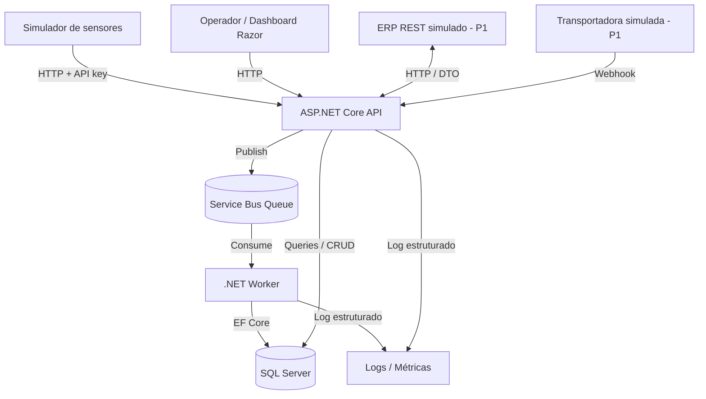

# CargoPulse — Especificação funcional e técnica

- **Versão:** 1.3
- **Data de referência:** 05/11/2026
- **Estado:** especificação em planejamento; implementação não iniciada.
- **Domínio:** telemetria de cargas sensíveis à temperatura e integração logística.

Este documento descreve regras de negócio, contratos e decisões técnicas do CargoPulse. O [catálogo de requisitos](requisitos.md) identifica RF/RNF, critérios de aceite e limites do MVP. A seção 20 organiza as entregas; a seção 23 delimita as decisões de engenharia pendentes. A implementação ainda não foi iniciada.

---

## 1. Visão geral

CargoPulse é uma plataforma de telemetria e integração logística para cargas sensíveis à temperatura. O fluxo previsto recebe medições de sensores simulados, processa eventos de forma assíncrona, preserva o histórico e gera alertas de temperatura. Integrações com sistemas externos simulados compõem uma etapa posterior.

### 1.1 Contexto operacional

Dados de transporte podem chegar duplicados, atrasados, inválidos ou durante períodos de indisponibilidade. A operação necessita de histórico consistente, identificação das últimas medições válidas, detecção de desvios de temperatura e rastreabilidade de falhas de processamento e integração.

### 1.2 Objetivo técnico

O sistema reúne ingestão HTTP, persistência relacional, mensageria, processamento idempotente e integração de contratos externos em uma aplicação local reproduzível.

### 1.3 Perfis de uso

- Operação logística: cadastro de dispositivos, veículos e entregas; consulta de medições e alertas.
- Desenvolvimento e validação: geração de eventos determinísticos, reprodução de falhas e reconciliação dos resultados.

### 1.4 Critérios de validação

- Execução local reproduzível a partir das instruções do README.
- Fluxo completo: simulador → API → fila → Worker → SQL Server → dashboard.
- Comportamento de duplicatas, ordenação temporal e falhas transitórias verificado por testes.
- Fronteiras explícitas entre domínio, casos de uso e infraestrutura.
- Resultados de teste e desempenho acompanhados das condições de execução.

---

## 2. Limites e estratégia de entrega

### 2.1 Prioridades

| Prioridade | Abrangência | Resultado |
|---|---|---|
| P0 — MVP | Cadastro, ingestão, fila, Worker, histórico, alertas, dashboard mínimo, testes e execução local | Fluxo local completo e reproduzível |
| P1 — Integrações | ERP REST simulado, webhooks de transportadoras, erros e reprocessamento | Sincronização e reprocessamento de integrações |
| P2 — Diferenciais | SOAP/XML, cache, Azure Functions, observabilidade ampliada, testes de carga avançados | Extensões opcionais após o MVP |

### 2.2 Fora do escopo do MVP

- Dispositivos físicos reais, firmware, modem GPS e protocolos industriais proprietários.
- Mapas comerciais ou rastreamento em tempo real de alta frequência.
- Microserviços distribuídos, Kubernetes, multi-tenant, faturamento, assinatura e aplicativo móvel.
- Machine learning, previsão de falha e análises avançadas.
- Hospedagem de produção; cloud paga não é requisito.
- Garantias de produção do emulador de Service Bus.

### 2.3 Princípio de execução

A entrega inicial percorre o fluxo completo com uma medição e um teste automatizado. Lotes, cenários adicionais de falha e interface são incorporados em incrementos posteriores. P1/P2 dependem de P0 funcional e reproduzível.

### 2.4 Cortes de escopo

P0 inclui cadastro, associação temporal, ingestão, histórico, alertas, diagnóstico e interface local. O reconhecimento de alerta é permitido; correção de leituras persistidas, alteração retroativa de vínculos e reprocessamento operacional de telemetria ficam fora do MVP. Cadastro e histórico não possuem exclusão física.

ERP, webhooks e reprocessamento de integrações pertencem a P1. Autenticação de produção, implantação em nuvem, cache, SOAP, Functions, outbox e metas de capacidade permanecem fora de P0. P2 depende de problema medido ou necessidade funcional identificada.

Cada incremento corresponde a requisitos identificados, testes aplicáveis e um marco da seção 20. Alterações no escopo ou nos limites do perfil local atualizam o catálogo e os critérios afetados antes da implementação.

---

## 3. Cenário de negócio

Uma transportadora fictícia transporta medicamentos refrigerados. Cada **Entrega** possui um estado operacional, uma faixa permitida de temperatura e um veículo. A associação entre entrega e dispositivo possui um intervalo de validade próprio. O dispositivo emite leituras de temperatura, umidade e localização com um identificador próprio de evento.

**Fluxo principal:**

1. Um operador cadastra um dispositivo, um veículo e uma entrega com faixa aceitável de temperatura.
2. Associa o dispositivo à entrega durante a viagem.
3. O simulador produz medições com `deviceId`, `eventId`, `occurredAtUtc`, temperatura, umidade e coordenadas opcionais.
4. A API autentica a origem, valida o contrato e publica mensagem na fila.
5. O Worker recebe a mensagem, valida as regras dependentes do banco, grava a leitura e atualiza projeções.
6. Se a temperatura estiver fora da faixa, gera um alerta associado à leitura.
7. O dashboard permite consultar histórico e alertas.
8. Na fase P1, uma integração externa importa pedidos e recebe atualizações do estado da entrega.

Os dados da aplicação e dos testes são sintéticos. Identificadores de frota e localização representam cenários fictícios, sem dados de clientes ou pessoas reais.

---

## 4. Capacidades técnicas

| Área | Aplicação prevista |
|---|---|
| C# / .NET | Domínio, API, Worker e simulador |
| ASP.NET Core / REST | Endpoints versionados, validação e documentação OpenAPI |
| SQL Server / EF Core | Modelo relacional, migrations, índices e consultas paginadas |
| Mensageria | Fila do Azure Service Bus e consumidor idempotente |
| Telemetria | Ingestão individual e em lote, eventos atrasados e duplicados |
| Integração ERP (P1) | Adaptador REST simulado, DTOs, transformação e tratamento de erros |
| Webhooks (P1) | Autenticação de origem, idempotência e ordenação de eventos |
| Qualidade | Testes unitários, integração, CI e logs estruturados |
| Interface operacional | MVC/Razor com consultas de histórico e alertas |

---

## 5. Stack técnica

| Camada | Escolha inicial | Justificativa |
|---|---|---|
| Linguagem e runtime | **C# / .NET 10 LTS** | Plataforma moderna, suporte de longo prazo |
| API / UI | **ASP.NET Core Web API + MVC/Razor** | Backend + demonstração web com pouca complexidade extra |
| Persistência | **SQL Server + EF Core** | Modelo relacional e migrations reproduzíveis |
| Fila | **Azure Service Bus**, emulador local | Contratos e SDK de mensageria relevantes para telemetria |
| Consumidor | **.NET Worker Service** | Processamento assíncrono separado da API |
| Testes | **xUnit + WebApplicationFactory + SQL real em testes de integração** | Evitar testes que mascaram diferenças de SQL |
| Ambiente | **Docker Compose** + .NET SDK | Windows e Linux, sem serviços pagos |
| CI | **GitHub Actions** | Build, análise estática e testes |
| Documentação | Markdown + OpenAPI | Referência técnica e descrição dos contratos |

**Observações de viabilidade:**

- O emulador do Azure Service Bus é restrito a desenvolvimento e testes. Mensagens e entidades não são preservadas após reinício; suas características operacionais diferem do serviço em nuvem.
- A execução do SQL Server em container Linux depende dos requisitos de plataforma e das condições de licença da versão utilizada.
- Dependências e imagens utilizam versões fixadas e registradas no README para reprodução do ambiente.
- A execução do MVP utiliza recursos locais, sem dependência de serviços Azure pagos.

Documentação oficial de referência:

- [.NET — versões e suporte](https://learn.microsoft.com/pt-br/dotnet/core/releases-and-support)
- [Azure Service Bus Emulator — visão geral](https://learn.microsoft.com/en-us/azure/service-bus-messaging/overview-emulator)
- [Azure Service Bus Emulator — execução local](https://learn.microsoft.com/en-us/azure/service-bus-messaging/test-locally-with-service-bus-emulator)
- [SQL Server no Docker](https://learn.microsoft.com/en-us/sql/linux/quickstart-install-connect-docker?view=sql-server-ver17)
- [Comparação de GUIDs e `uniqueidentifier`](https://learn.microsoft.com/en-us/sql/connect/ado-net/sql/compare-guid-uniqueidentifier-values?view=sql-server-ver17)
- [Service Bus — contagem de entregas e DLQ](https://learn.microsoft.com/en-us/azure/service-bus-messaging/service-bus-dead-letter-queues)
- [Testes de integração ASP.NET Core](https://learn.microsoft.com/en-us/aspnet/core/test/integration-tests?view=aspnetcore-10.0)

---

## 6. Arquitetura

### 6.1 Diagrama lógico



No MVP, o dashboard compartilha o host ASP.NET Core com a API. Regras de negócio permanecem fora de controllers e views.

### 6.2 Responsabilidades

- `CargoPulse.Domain`: entidades, invariantes, enums e decisões puras de negócio; **sem referências** a EF Core, ASP.NET, Service Bus ou infraestrutura.
- `CargoPulse.Application`: casos de uso, portas/interfaces, DTOs internos, validação de aplicação e orquestração; **sem lógica concreta** de banco ou HTTP externo.
- `CargoPulse.Infrastructure`: DbContext, migrations, repositórios/queries, cliente de Service Bus, integração externa e observabilidade.
- `CargoPulse.Api`: controllers/endpoints, autenticação, contratos HTTP, mapeamento, tratamento de erros e views Razor.
- `CargoPulse.Worker`: `BackgroundService`, consumo de mensagens, política de retry, transações e confirmação.
- `CargoPulse.Simulator`: CLI/console para gerar eventos determinísticos e cenários de falha; não depende de hardware.

### 6.3 Regras de arquitetura

1. `Domain` não conhece `Application`, `Infrastructure`, `Api` ou `Worker`.
2. `Application` pode depender de `Domain`; define abstrações necessárias.
3. `Infrastructure` implementa abstrações, não decide regras essenciais de negócio.
4. `Api`, `Worker` e `Simulator` não implementam regras duplicadas de domínio.
5. Operações HTTP não devem conter consultas EF diretamente em controllers.
6. Interfaces e repositórios atendem a usos concretos. A adoção de CQRS/event sourcing ou bibliotecas adicionais depende de benefício demonstrável.
7. Mensagens e endpoints são contratos versionados.
8. Padrões e abstrações atendem a problemas identificados e verificáveis.

O detalhamento de modularidade, SOLID (incluindo open/closed), reutilização e resiliência atende a RNF-02 e RNF-06. A revisão de engenharia da seção 23 define as fronteiras e políticas concretas; circuit breaker depende da identificação da dependência afetada e dos critérios de abertura/recuperação.

### 6.4 Entrega sem perda silenciosa

No MVP, a API retorna **202 Accepted somente depois que o broker confirma o aceite da mensagem**. Se o publish falhar, retorna erro apropriado, registra correlação e permite ao cliente repetir com o mesmo `eventId`.

O consumidor assume entrega **at-least-once** e aplica **idempotência no SQL**. O emulador local não oferece garantia de durabilidade fim a fim; a arquitetura não estabelece entrega exactly-once.

Um *transactional outbox* para sincronização de mutação SQL e publicação de eventos derivados é uma alternativa P2, condicionada à necessidade de consistência entre as duas operações. A ausência desse mecanismo mantém o risco de dual-write nos fluxos que combinarem ambas.

---

## 7. Modelo de domínio

### 7.1 Entidades P0

| Entidade | Campos essenciais | Regra relevante |
|---|---|---|
| `Device` | `Id`, `ExternalCode`, `Name`, `IsActive`, `CreatedAtUtc` | Código externo único; inativo não aceita novas leituras |
| `Vehicle` | `Id`, `FleetCode`, `Description` | Código de frota único (fictício) |
| `Shipment` | `Id`, `ExternalReference`, `VehicleId`, `Status`, `MinTempC`, `MaxTempC`, `CreatedAtUtc`, `StartedAtUtc?`, `FinishedAtUtc?` | `MinTempC < MaxTempC`; status tem transições válidas |
| `DeviceAssignment` | `Id`, `DeviceId`, `ShipmentId`, `ValidFromUtc`, `ValidToUtc?` | Dispositivo e entrega possuem no máximo uma associação em cada instante; intervalos semiabertos |
| `TelemetryReading` | `Id`, `DeviceId`, `EventId`, `OccurredAtUtc`, `ReceivedAtUtc`, `TemperatureC`, `HumidityPercent?`, `Latitude?`, `Longitude?`, `ShipmentId?`, `PayloadHash` | Chave única `(DeviceId, EventId)` |
| `TemperatureAlert` | `Id`, `ReadingId`, `ShipmentId`, `Type`, `ObservedTempC`, `CreatedAtUtc`, `AcknowledgedAtUtc?` | No máximo um alerta do mesmo tipo por leitura |
| `ProcessingFailure` | `Id`, `CorrelationId`, `DeviceId?`, `EventId?`, `Category`, `Reason`, `DetectedAtUtc`, `ResolutionStatus` | Rastrear falhas definitivas sem dados sensíveis |

### 7.2 Entidades P1

- `ExternalSystem`: origem/destino de integração, habilitação e configuração **sem segredos em banco de demonstração**.
- `ExternalMapping`: relação entre códigos externos e entidades internas.
- `IntegrationAttempt`: destino, operação, status, tentativas, último HTTP status, correlação.
- `CarrierTrackingEvent`: identificador do evento, transportadora, estado, `occurredAtUtc`, payload normalizado.

### 7.3 Regras de negócio

**RB-01 — Unicidade.** Uma medição é identificada por `(deviceId, eventId)`. Retransmissão com os mesmos valores de negócio não cria nova leitura ou efeito colateral. Mesmo identificador com conteúdo conflitante preserva a primeira leitura e produz diagnóstico de integridade; o conflito pode ser detectado após `202`, no consumidor.

**RB-02 — Tempo de evento e recepção.** `occurredAtUtc` representa a medição; `receivedAtUtc` é atribuído pela API no recebimento, transportado no envelope e preservado pelo Worker. Reenvios podem ter recepção/correlação diferentes sem alterar a identidade do evento.

**RB-03 — Ordem temporal.** Leituras atrasadas entram no histórico. A última leitura é o máximo de `(occurredAtUtc, eventId)`: no empate, vence o maior UUID em representação canônica minúscula, sem hífens, comparada ordinalmente. Aplicação e SQL utilizam a mesma ordem, independentemente da ordem nativa de `uniqueidentifier`.

**RB-04 — Associação temporal.** Intervalos são `[ValidFromUtc, ValidToUtc)`, com fim nulo equivalente a aberto. Intervalos adjacentes são válidos; sobreposição para o mesmo dispositivo ou para a mesma entrega é rejeitada, inclusive sob concorrência. O vínculo da leitura usa `occurredAtUtc` e as associações existentes no processamento. Sem associação, a leitura persiste com entrega nula e indicação consultável; não há associação presumida pelo estado atual.

**RB-05 — Alerta.** Temperatura abaixo de `MinTempC` ou acima de `MaxTempC` gera um alerta vinculado à leitura e à entrega. Limites inclusivos são válidos; leitura sem entrega não gera alerta de faixa. `(ReadingId, Type)` é único. Reconhecimento é idempotente e preserva o primeiro `AcknowledgedAtUtc`.

**RB-06 — Valores de entrada.** Unidades, precisão e limites seguem o [perfil do MVP](requisitos.md#4-limites-do-mvp). Valores não representáveis na escala aceita são rejeitados, sem arredondamento silencioso. Zero é válido quando estiver na faixa; ausência de campo obrigatório não equivale ao seu valor padrão.

**RB-07 — Datas.** Timestamps de entrada possuem offset explícito e são normalizados para UTC. A precisão aceita é preservada; exemplos públicos usam `Z`. A tolerância de evento futuro utiliza `receivedAtUtc` e o limite do perfil local. Eventos atrasados não são descartados por idade. A interface identifica o timezone de apresentação.

**RB-08 — Retentativa.** Falhas transitórias utilizam limite de entregas, backoff e budgets do perfil local. Falha permanente de contrato, dispositivo inexistente no consumidor ou conflito de conteúdo segue para diagnóstico/DLQ sem retry de negócio. Retentativas de transporte não recebem orçamento adicional ao da operação.

**RB-09 — Commit e falha definitiva.** `Complete` ocorre após commit SQL ou confirmação de duplicata já persistida. Falha antes do commit mantém a mensagem elegível a redelivery; falha no ACK após commit não desfaz a leitura. Mensagens irrecuperáveis ou com tentativas esgotadas seguem para DLQ com motivo/correlação. O diagnóstico é registrado no SQL quando disponível; indisponibilidade do SQL não remove os metadados de falha da DLQ.

**RB-10 — Estado da entrega.** A entrega nasce em `Created`, com início e fim nulos. Transições permitidas: `Created → InTransit`, `Created → Cancelled`, `InTransit → Delivered` e `InTransit → Cancelled`. Repetir o estado atual é idempotente; estados terminais não reabrem e transições inválidas produzem `409`. O relógio da aplicação atribui `CreatedAtUtc` no cadastro, `StartedAtUtc` no início e `FinishedAtUtc` no encerramento. Uma data não pode preceder a anterior; regressão do relógio impede a transição com `409`, sem alteração parcial. Status não modifica implicitamente associações ou histórico; eventos externos atrasados não retrocedem o estado.

**RB-11 — Segredos e logs.** API keys, connection strings, tokens e dados pessoais não integram logs, versionamento, fixtures públicas ou exemplos. Diagnósticos preservam identidade e categoria sem expor credenciais ou stack trace público.

**RB-12 — Dispositivo ativo.** A API consulta existência/estado antes da publicação: inexistente retorna `404`, inativo `409`. A validação é o ponto de admissão; mudança posterior de estado não cancela a mensagem validada, inclusive se ocorrer entre validação e confirmação do broker. O Worker preserva o aceite anterior e não rejeita apenas porque o dispositivo foi desativado depois. Não há transação distribuída entre mudança de estado e publicação.

**RB-13 — Preservação do histórico.** Leituras, faixas de entregas cadastradas e início/identidade das associações não são editados em P0. Uma associação aberta pode receber um fim válido uma única vez; repetir o mesmo fim é idempotente. Fim não posterior ao início produz `400`; alteração de fim já definido ou exclusão de leitura vinculada produz `409`. Associação criada depois de uma leitura não refaz vínculos anteriores; redelivery de evento persistido preserva o resultado original. Reclassificação retroativa exige funcionalidade posterior auditável.

---

## 8. Contratos de eventos

### 8.1 TelemetryReceived V1 — payload público de ingestão

```json
{
  "eventId": "e1f2b2e7-c23a-41cb-8acc-d54f1d12ec6a",
  "deviceId": "d22db4c2-a0dd-4fd4-af9e-9c5a999a0e17",
  "occurredAtUtc": "2026-11-05T14:30:00Z",
  "temperatureC": 7.2,
  "humidityPercent": 62.0,
  "latitude": -23.3103,
  "longitude": -51.1628
}
```

**Contrato:**

- `eventId`, `deviceId`, `occurredAtUtc` e `temperatureC` são obrigatórios.
- Os IDs são UUIDs válidos e não nulos; `eventId` é estável entre retentativas.
- `humidityPercent`, `latitude`, `longitude` são opcionais segundo RB-06.
- `temperatureC` é número decimal, não string.
- JSON inválido, campos obrigatórios ausentes e timestamps malformados resultam em `400` com `ProblemDetails`, sem exposição de segredos.
- A mensagem na fila identifica versão do contrato, `eventId`, `correlationId` e `receivedAtUtc` atribuído pela API; seu conteúdo é composto pelo payload validado e metadados, sem entidades EF. O hash utiliza apenas campos de negócio normalizados, excluindo os metadados de recepção.

### 8.2 Lotes

O endpoint recebe `{ "items": [ ... ] }`. Os limites de corpo e contagem estão no catálogo. Autenticação inválida, JSON sintaticamente inválido, envelope incorreto, corpo excessivo ou contagem inválida rejeitam a requisição inteira, antes de qualquer publicação.

Com envelope válido, a resposta é `200 OK` com um resultado para cada posição original, inclusive quando todos os itens falham. Cada resultado contém índice, `eventId` quando legível, status e código/motivo de erro sem segredos. Estados por item:

- `accepted`: confirmação do broker, sem promessa de persistência já concluída.
- `invalid`: contrato ou dispositivo rejeitado antes de publicar, com código equivalente ao da ingestão individual.
- `publishFailed`: falha, timeout ou ausência de orçamento para publicação; motivo distingue tentativa falha de item não tentado.

O resultado inclui contagens reconciliadas com a quantidade de posições. Não há `202` global para lote. Timeout pode ocorrer após aceite do broker sem resposta ao publicador: `publishFailed` não garante ausência da mensagem. Repetição utiliza os mesmos IDs e o consumidor idempotente resolve eventuais duplicatas. Cancelamento do cliente pode impedir a resposta; mensagens já confirmadas permanecem válidas.

---

## 9. API HTTP — contrato planejado

Rotas de negócio possuem base `/api/v1`. Endpoints `/health/*` ficam na raiz. Todos os itens são planejados; esta tabela não indica implementação.

| Método | Rota | Finalidade | Prioridade |
|---|---|---|---|
| `GET` | `/health/live` | Liveness | P0 |
| `GET` | `/health/ready` | Readiness incluindo dependências necessárias | P0 |
| `POST` | `/devices` | Cadastrar dispositivo | P0 |
| `GET` | `/devices` | Listar com paginação | P0 |
| `GET` | `/devices/{id}` | Detalhar dispositivo | P0 |
| `PATCH` | `/devices/{id}/status` | Ativar/desativar dispositivo | P0 |
| `POST` | `/vehicles` | Cadastrar veículo | P0 |
| `GET` | `/vehicles` | Listar veículos | P0 |
| `GET` | `/vehicles/{id}` | Detalhar veículo | P0 |
| `POST` | `/shipments` | Criar entrega | P0 |
| `GET` | `/shipments` | Listar entregas | P0 |
| `GET` | `/shipments/{id}` | Detalhar entrega e associações | P0 |
| `PATCH` | `/shipments/{id}/status` | Alterar estado conforme RB-10 | P0 |
| `POST` | `/shipments/{id}/assignments` | Associar dispositivo com intervalo | P0 |
| `PATCH` | `/assignments/{id}/end` | Encerrar associação aberta | P0 |
| `POST` | `/telemetry` | Receber uma medição | P0 |
| `POST` | `/telemetry/batches` | Receber lote e retornar relatório por item | P0 |
| `GET` | `/devices/{id}/readings` | Consultar histórico paginado e ordenado | P0 |
| `GET` | `/shipments/{id}/readings` | Consultar histórico da entrega | P0 |
| `GET` | `/shipments/{id}/latest-reading` | Última medição por tempo do evento | P0 |
| `GET` | `/shipments/{id}/alerts` | Consultar alertas | P0 |
| `POST` | `/alerts/{id}/acknowledge` | Reconhecer alerta | P0 |
| `GET` | `/processing-failures` | Consultar falhas registradas no SQL | P0 |
| `POST` | `/integrations/erp/sync` | Importação manual de ERP simulado | P1 |
| `POST` | `/webhooks/carriers/{carrier}` | Receber evento de rastreio | P1 |
| `GET` | `/integrations/attempts` | Ver erros e estado de envio | P1 |
| `POST` | `/integrations/attempts/{id}/retry` | Reprocessar erro tratável | P1 |

### 9.1 Padrões HTTP

- `201 Created` para recurso criado; `202 Accepted` para mensagem individual confirmada na fila; `200 OK` com relatório para lote válido; `204 No Content` para alteração idempotente de estado, encerramento de associação e reconhecimento de alerta.
- `400 Bad Request` para contrato inválido; `401` para chave ausente/inválida; `403` para operação não permitida quando houver autorização; `404` para recurso inexistente; `409` para conflito de domínio; `413` para corpo excessivo; `503` para indisponibilidade/timeout da dependência. Rate limiting e resposta `429` não integram o aceite de P0.
- `ProblemDetails` para erros da requisição; erros por item seguem o relatório de lote da seção 8.2. `correlationId` permite diagnóstico, sem stack trace em resposta pública.
- Paginação e filtros seguem o perfil do catálogo. Histórico usa a ordem de RB-03; cadastros usam código normalizado e ID. A última leitura ausente retorna `404`; coleções sem dados retornam `200` com lista vazia.
- OpenAPI deve refletir comportamento de processamento **eventual**: receber `202` não significa que o Worker já persistiu a medição.

---

## 10. Persistência e consultas

### 10.1 Restrições/indexação obrigatórias

- `Device.ExternalCode` unique.
- `Vehicle.FleetCode` unique.
- `Shipment.ExternalReference` unique.
- `TelemetryReading (DeviceId, EventId)` unique (proteção idempotente concorrente no banco).
- `TelemetryReading (DeviceId, OccurredAtUtc DESC, EventId)` para histórico/última medição.
- `TelemetryReading (ShipmentId, OccurredAtUtc DESC, EventId)` para consultas por entrega.
- `TemperatureAlert (ReadingId, Type)` unique.
- `DeviceAssignment` indexado por dispositivo e por entrega com `ValidFromUtc`/`ValidToUtc`; a proteção transacional impede sobreposições e encerramento que invalide leituras, mesmo com concorrência.

A ordenação final das consultas segue RB-03. A presença de `EventId` no índice não substitui a comparação canônica exigida para desempate.

### 10.2 Decisões de persistência

- Migrations EF Core versionadas, com aplicação controlada.
- Conversões de UTC/decimal explicitamente definidas; valores de medição devem manter precisão coerente.
- Paginação e filtros executados no SQL, não em coleção carregada inteiramente em memória.
- Testes de unicidade/constraints devem atingir SQL Server de fato; `EF Core InMemory` não substitui esses testes.
- Transação de gravação de leitura + alerta onde necessário; ao receber duplicata, consultar estado e fazer ACK sem refazer efeitos colaterais.

---

## 11. Worker, falhas e observabilidade

### 11.1 Processamento por mensagem

1. Validação de versão/envelope e propagação da correlação/recepção atribuídas pela API.
2. Verificação da chave e do payload de negócio normalizado; duplicata idêntica confirma o resultado persistido e conflito preserva esse resultado com diagnóstico.
3. Para evento novo, verificação de existência do dispositivo. O estado ativo já validado pela API segue RB-12.
4. Transação SQL para resolução temporal da associação, medição e eventual alerta; isolamento/proteções impedem corrida com encerramento e respeitam unicidade.
5. Commit antes de `Complete`. Concorrência na inserção retorna ao tratamento de duplicata/conflito, sem repetir efeitos.
6. Falha transitória mantém elegibilidade para redelivery com orçamento limitado; falha permanente ou tentativas esgotadas seguem RB-09.

### 11.2 Budgets, retentativas e cancelamento

Os valores iniciais são definidos no [perfil local](requisitos.md#4-limites-do-mvp), correspondente a RNF-06. A configuração do transporte e os retries internos do SDK respeitam o mesmo orçamento; tentativas de negócio adicionais não são empilhadas dentro de uma entrega.

Cancelamento antes do commit interrompe a operação sem ACK; transação não confirmada é revertida. Se o commit já ocorreu, falha/cancelamento na confirmação permite redelivery idempotente. Perda de lock não autoriza nova confirmação com lock expirado. A classificação de erro inclui tentativa, causa e identidade, sem descarte silencioso.

### 11.3 Logs e medições mínimas

Logs estruturados incluem `timestamp`, `level`, `operation`, `deviceId`, `eventId`, `correlationId`, `elapsedMs` e `result` quando disponíveis. Mensagem inválida mantém pelo menos identidade do broker, correlação disponível e categoria.

Contadores incluem `received`, `published`, `processed`, `duplicate`, `invalid`, `failed` e `alertCreated`, com unidade documentada: requisição/item, entrega de mensagem ou evento de negócio. Eventos fora de ordem são identificáveis pelo tempo do evento, sem alterar o timestamp original.

Resultados de desempenho registram hardware, quantidade de mensagens, configuração, duração, latências e limitações do emulador utilizados na medição. Falha definitiva fica consultável no SQL quando disponível ou nos metadados da DLQ.

---

## 12. Autenticação e segurança

**MVP local:**

- Ingestão de telemetria autenticada por API key de demonstração configurada por variável de ambiente.
- Endpoints administrativos e interface limitados a loopback enquanto a autenticação local não estiver disponível. O mecanismo de demonstração não estabelece controles de produção.
- Webhooks P1 com assinatura HMAC sobre corpo bruto e timestamp, controle de replay e segredo por origem configurado pelo ambiente; o contrato e a janela temporal são definidos antes de M6.
- TLS ao sair do localhost; o Docker de demonstração não exige certificado público.
- Limite de tamanho de requisição/lote; validação de entrada; tratamento de falhas sem expor stack trace.
- Credenciais sintéticas de demonstração, sem tokens corporativos ou dados pessoais.

A validação de CI inclui detecção de segredos. O README identifica os controles de demonstração e suas limitações de exposição.

---

## 13. Interface web (P0)

### 13.1 Telas mínimas

1. **Resumo operacional:** número de entregas, últimas leituras, alertas ativos, indicadores básicos de processamento.
2. **Entregas:** listar e abrir detalhes, faixa de temperatura, status, dispositivo associado.
3. **Detalhe de entrega:** histórico temporal de temperatura, últimas medições e alertas.
4. **Dispositivos:** listar, ativar/desativar e inspecionar últimas leituras.
5. **Falhas (visão de desenvolvimento):** mostrar falhas registradas com correlação, sem expor dados sigilosos.

A interface utiliza Razor e JavaScript para as interações necessárias. Gráficos podem ser representados por biblioteca leve ou SVG/HTML. O layout é responsivo e a atualização periódica ocorre por polling.

### 13.2 Requisitos de UX

- UTC e horário local identificados.
- Dados vazios, erro e loading tratados.
- Leituras com flags de atraso/fora de faixa de maneira explícita.
- Uma entrega sem sensor ou sem leitura não deve gerar erro na tela.

---

## 14. Simulador de dispositivos

CLI com seed (`--seed`), instante-base UTC (`--start-at-utc`) e cenários explícitos. Igualdade desses parâmetros reproduz IDs, tempos e medições; credenciais vêm da configuração local.

| Modo | Comportamento | Objetivo de teste |
|---|---|---|
| `normal` | Medições regulares na faixa | Caminho feliz |
| `temperature-spike` | Temperatura acima/abaixo do limite | Alertas |
| `duplicate` | Repete o mesmo `eventId` e payload | Idempotência |
| `conflicting-duplicate` | Mesmo `eventId`, payload diferente | Conflito de integridade |
| `out-of-order` | Envia eventos temporalmente invertidos | Histórico e visão mais recente |
| `invalid` | Campos ausentes/fora de faixa | Validação |
| `batch` | Gera lote com até o limite definido | Publicação parcial e teste de carga funcional |
| `temporary-failure` | Cenário de dependência indisponível | Retentativa e diagnóstico |

Sintaxe de execução prevista para o simulador, ainda sem validação de implementação:

```bash
dotnet run --project src/CargoPulse.Simulator -- --scenario normal --count 20 --seed 42 --start-at-utc 2026-11-05T14:30:00Z
dotnet run --project src/CargoPulse.Simulator -- --scenario duplicate --count 10 --seed 42 --start-at-utc 2026-11-05T14:30:00Z
dotnet run --project src/CargoPulse.Simulator -- --scenario out-of-order --count 30 --seed 42 --start-at-utc 2026-11-05T14:30:00Z
```

O simulador atua como cliente HTTP externo. A geração de dados percorre a API, sem inserção direta no SQL Server.

---

## 15. Integração ERP REST (P1)

### 15.1 Objetivo

A integração consome uma API de ERP fictício e transforma pedidos externos em entregas internas, com mapeamento auditável e política de erro.

### 15.2 Contrato esperado

- `GET /orders?updatedSince=...` no mock ERP, ou endpoint equivalente documentado.
- DTO externo separado do domínio.
- Mapeamento de pedido: código externo, tipo de carga, faixa permitida e referência de veículo. Campos de agendamento do ERP não substituem os timestamps reais do ciclo de vida; sua incorporação ao modelo P1 depende do contrato de M5.
- Uma entrega por origem/identificador externo, com versão aplicada registrada; reenvio e atualização de versão não criam uma segunda entrega.
- Registro de tentativa, código de resposta e possibilidade de reprocessamento seguro.

### 15.3 Falhas de integração

- Timeout, `429`, `500/503`: retentativas limitadas e registradas.
- `400/422` por contrato externo inválido: erro permanente até correção.
- Mapeamento inexistente: estado `NeedsMapping`, correção manual e reenvio.
- Reprocessar não pode duplicar entrega.

### 15.4 SOAP/XML (P2)

A extensão P2 prevê um segundo ERP simulado com WSDL e envelope XML. Sua implementação depende da conclusão da integração REST.

---

## 16. Webhooks de transportadoras (P1)

- Receber `eventId`, `trackingCode`, `status`, `occurredAtUtc` e assinatura de origem.
- Autenticidade verificada por HMAC e janela temporal de replay, conforme contrato da origem.
- Persistir evento original normalizado com chave de idempotência.
- Atualizar visão de estado **somente se** a transição e o tempo forem válidos. Eventos atrasados ficam no histórico, sem regressão de estado.
- Códigos HTTP compatíveis com o redelivery do emissor fictício, com comportamento de entrega verificado por testes.

---

## 17. Estratégia de testes

### 17.1 Pirâmide e princípios

**Unitários:** domínio, faixa de temperatura, validações puras, máquina de estados, desempate temporal e transformação de DTOs.

**Integração:** EF Core e SQL Server em container para constraints, transações e migrações; endpoints com `WebApplicationFactory`; consumidor com fila/emulador conforme disponibilidade. Suites rápidas e suites dependentes de Docker possuem execução e pré-requisitos separados.

**Fim a fim:** inicialização dos serviços pelo Compose, geração de dados e verificação automatizada dos resultados no banco, na API e no dashboard.

**Testes adversariais:** cada regra criada ou alterada possui cobertura de comportamento válido e cenários destinados a violar suas invariantes. A seleção considera risco, fronteiras e combinações raras: valores no limite e imediatamente fora dele, duplicatas concorrentes ou conflitantes, timestamps iguais ou invertidos, falha entre commit e ACK, publicação parcial, cancelamento e recuperação após indisponibilidade. As asserções verificam resultados observáveis. Seed, relógio controlável e sincronização permitem reprodução sem dependência de sorte ou esperas arbitrárias. O resultado esperado depende de um requisito definido.

### 17.2 Matriz obrigatória

| ID | Caso | Resultado verificável |
|---|---|---|
| T01 | Medição válida | `202` e, após processamento eventual, 1 leitura no SQL |
| T02 | Mesmo evento enviado 2× | Exatamente 1 leitura, sem efeito colateral repetido |
| T03 | Mesmo ID com payload diferente | Conflito registrado, sem adulteração da leitura persistida |
| T04 | Evento antigo recebido após novo | Ambos no histórico, última leitura continua sendo a mais recente por `occurredAtUtc` |
| T05 | Temperatura fora da faixa | 1 alerta correspondente, sem duplicação |
| T06 | Falha temporária de DB | Falha observável, mensagem não marcada como concluída antes do commit, processamento posterior testado |
| T07 | Lote com itens válidos e inválidos | Relatório por item e persistência apenas dos aceitos processados |
| T08 | 1000 medições geradas | Sem perda não explicada; contagens reconciliadas no cenário local |
| T09 | Leitura sem associação temporal | Persiste sem entrega, nunca vincula a entrega errada |
| T10 | Dispositivo inexistente/inativo na ingestão | `404`/`409`, respectivamente, sem publicação; comportamento por item equivalente no lote |
| T11 | Falha ERP HTTP 503 (P1) | Retentativa limitada, registro de tentativa, diagnóstico |
| T12 | Webhook duplicado/atrasado (P1) | Não duplica evento nem retrocede status |
| T13 | Campo obrigatório ausente | `400` com `ProblemDetails` e sem publish |
| T14 | Endpoint sem chave válida | `401`, sem aceitar medição nem consultar/publicar dados protegidos |
| T15 | Cadastros duplicados, normalização e concorrência | Uma linha por código normalizado; referência inválida rejeitada; conflito `409` sem alteração parcial |
| T16 | Intervalos adjacentes/sobrepostos, inclusive concorrentes | Instante final pertence apenas à próxima associação; dispositivo/entrega não recebem duas associações sobrepostas |
| T17 | Empates temporais e payloads semanticamente equivalentes | Mesma última leitura em todas as permutações; UUID segue RB-03, inclusive quando ordem nativa do banco difere; formatação/offset equivalentes não geram conflito |
| T18 | Limites numéricos, campos ausentes, zero e precisão excedida | Fronteiras aceitas; valor imediatamente externo ou não representável rejeitado sem arredondamento/publicação |
| T19 | Offset ausente, equivalente e relógio no limite futuro | UTC preservado; falta de offset ou limite futuro excedido rejeitado; atraso válido permanece no histórico |
| T20 | Falha ou timeout de publicação, inclusive após aceite real do broker | Sem falso aceite; `503` individual ou `publishFailed` por item; repetição do ID produz no máximo uma leitura |
| T21 | Processo interrompido após commit e antes do ACK | Redelivery encontra uma leitura e no máximo um alerta; confirmação posterior não repete efeitos |
| T22 | Cancelamento/perda de lock antes, durante e após commit | Nenhum ACK antecipado; transação pendente reverte; resultado confirmado permanece idempotente, inclusive quando a perda não incrementa o contador do broker |
| T23 | Paginação, filtros e histórico sem dados | Limites inválidos retornam `400`; intervalo semiaberto e ordem estável sem repetição/omissão em conjunto fixo; lista vazia válida |
| T24 | Todas as transições e repetições de status | Apenas transições RB-10 são aceitas; estado terminal não reabre; datas não retrocedem; repetição não muda timestamps |
| T25 | Reconhecimento de alerta repetido/concorrente | Uma confirmação observável, primeiro timestamp preservado; alerta inexistente retorna `404` |
| T26 | Dependência indisponível ou lenta | Liveness `200`; readiness `503` dentro do timeout configurado; recuperação restabelece readiness |
| T27 | Erros públicos, logs, correlação e contrato | `ProblemDetails` coerente, sem segredos/stack trace público; evento rastreável do recebimento ao resultado |
| T28 | Simulação repetida com seed e instante-base iguais | Mesmos IDs, payloads e ordem do cenário; execução usa HTTP e relatório reconciliado |
| T29 | Interface vazia, erro de dependência e eventos atrasados | Estados identificados, timezone explícito, sem falha por entrega sem sensor/leitura |
| T30 | Abandono/expiração até o limite, erro permanente e versão desconhecida | Contagem do broker e budgets respeitados; backoff dentro da faixa; erro permanente sem retry de negócio; DLQ com motivo/correlação |
| T31 | Ambiente limpo, migrações e dados fictícios reaplicados | Restore/build/test reproduzíveis; migração/seed repetidos não duplicam dados; versões e pré-requisitos registrados |
| T32 | Encerramento de associação e cadastro retroativo | Fim que exclui leitura vinculada retorna `409`; repetição do mesmo fim é idempotente; histórico anterior não é reclassificado |
| T33 | Desativação após validação/aceite e novas tentativas | Mensagem previamente validada ainda processa; nova validação com dispositivo inativo retorna `409` |
| T34 | Lote vazio, excessivo, misto, integralmente inválido ou sem broker | `400`/`413` globais antes de publicar; envelope válido retorna `200` e um resultado por posição, inclusive falha integral |
| T35 | Assinatura adulterada ou replay de webhook (P1) | Rejeição sem atualização de estado; evento autêntico atrasado não causa regressão |
| T36 | ERP antigo/conflitante, mapeamento ausente e retries concorrentes (P1) | Versão antiga/conflitante não sobrescreve a atual; `NeedsMapping` persiste até correção; reprocessamento produz um efeito de negócio |

### 17.3 Teste de carga funcional

O cenário funcional de carga utiliza um conjunto fechado de **1000 eventos**, com prazo finito de teste registrado antes da execução, e registra:

- eventos gerados, válidos, inválidos, aceitos pelo broker, processados, duplicados e falhos;
- tempo total, latência e throughput observados;
- configuração do Worker, recursos de máquina e limitações conhecidas do emulador;
- query de reconciliação que prove a soma dos resultados.

A reconciliação separa tentativas HTTP, entregas do broker e identidades de negócio. No cenário sem falhas, cada evento válido confirmado pelo broker possui uma leitura ao término, sem pendências. Nos cenários de falha, identidades confirmadas possuem leitura ou diagnóstico terminal justificável; mensagens pendentes ao fim do prazo reprovam o cenário. Conflitos distinguem o payload preservado do payload rejeitado.

Os resultados caracterizam apenas o cenário e o ambiente medidos. Capacidade de produção e SLA dependem de validação específica; otimizações utilizam essas medições como baseline.

---

## 18. Organização do repositório

Estrutura técnica prevista para a implementação:

```text
CargoPulse/
├── src/
│   ├── CargoPulse.Api/
│   ├── CargoPulse.Domain/
│   ├── CargoPulse.Application/
│   ├── CargoPulse.Infrastructure/
│   ├── CargoPulse.Worker/
│   └── CargoPulse.Simulator/
├── tests/
│   ├── CargoPulse.UnitTests/
│   ├── CargoPulse.IntegrationTests/
│   └── CargoPulse.EndToEndTests/       # conforme disponibilidade da infraestrutura
├── docs/
│   ├── especificacao.md
│   └── requisitos.md
├── infra/
│   ├── servicebus/                    # configuração local do emulador
│   └── sql/                           # scripts opcionais de desenvolvimento
├── .github/workflows/
├── .env.example
├── .editorconfig
├── Directory.Build.props              # conforme necessidade de configuração comum
├── docker-compose.yml
├── CargoPulse.sln
├── README.md
└── LICENSE                            # definição pendente
```

A árvore representa a estrutura prevista, sem indicar arquivos já implementados. A documentação técnica pública está concentrada em `docs/`. Requisitos e limites possuem catálogo próprio; arquitetura, regras, contratos e cenários de teste permanecem nesta especificação. Documentos adicionais dependem de conteúdo e uso próprios. Decisões com alternativas e consequências relevantes podem ser registradas em ADRs curtos.

---

## 19. Critérios de desenvolvimento e qualidade

- Ambiente local com versões de SDK, Docker e Compose identificadas.
- Configuração de SDK em `global.json` e formatação em `.editorconfig`.
- Nullable reference types e análise estática habilitados; build sem warnings pendentes de código, templates ou geradores antes da adoção de `TreatWarningsAsErrors`.
- Contratos e testes mínimos do caso de uso definidos antes da expansão funcional.
- Incrementos que percorrem o fluxo completo, com validação de comportamento e falhas.
- Injeção de dependência, `async/await` e `CancellationToken` nas operações aplicáveis.
- README, OpenAPI e testes atualizados conforme alterações de comportamento.
- Formatação e análise estática verificadas pelo CI.
- Alterações acompanhadas de descrição do comportamento, forma de verificação, riscos e evidências de teste.
- Versões explícitas de dependências e imagens, com atualização controlada.
- Credenciais, arquivos `.env`, dados de banco e artefatos de build excluídos do versionamento.

### 19.1 Definição de pronto por funcionalidade

- [ ] IDs RF/RNF identificados, contrato e aceite verificável, com decisões do marco resolvidas.
- [ ] Implementação compilando sem erro.
- [ ] Comportamento positivo e cenários adversariais verificados, conforme seção 17.1.
- [ ] Logs suficientes para diagnóstico e sem segredos.
- [ ] Migração documentada quando houver alteração de banco.
- [ ] Endpoint e contrato atualizados quando aplicável.
- [ ] Documentação técnica compatível com o comportamento entregue.
- [ ] Execução local reproduzível, com limitações identificadas.

---

## 20. Etapas, dependências e critérios de saída

### 20.1 Preparação de engenharia

O catálogo de RF/RNF define a base de escopo. Antes de M0, a revisão de arquitetura delimita módulos, dependências e responsabilidade das transações; SOLID, open/closed e compartilhamento de regras atendem a RNF-02. Políticas concretas de resiliência atendem a RNF-06, com circuit breaker somente quando houver dependência e recuperação que o justifiquem. Essa revisão não exige a implementação de P1/P2.

### 20.2 Entregas

A sequência obrigatória é M0 → M1 → M2 → M3 → M4. Cada marco depende do aceite do anterior. M2 entrega um fluxo pequeno já com proteções de integridade; M3 amplia a cobertura das falhas. P0 só está aceito após M4 e os critérios da seção 21. As entregas abaixo estão planejadas, sem conclusão de implementação.

Todo marco inclui cenários adversariais para as regras já implementadas. As referências abaixo indicam evidências mínimas; um marco posterior não adia a validação da lógica criada no incremento atual.

| Marco | Escopo e requisitos | Evidência de saída |
|---|---|---|
| M0 — Fundação | Solução e referências, configuração, health endpoints, Compose e CI. RF-13; início de RNF-01, RNF-02, RNF-04, RNF-09 e RNF-11. | Restore/build/test aprovados, prontidão das dependências verificada, T26/T31 aplicáveis e comandos documentados. |
| M1 — Cadastro e domínio | RF-01–RF-03 e parte inicial de RF-04: dispositivos, veículos, entregas, estados e associações; EF/migrations e constraints. | Cadastros e consultas por API; T15, T16, T18, T23, T24 e T32 no escopo de cadastro, incluindo concorrência de associações. |
| M2 — Fluxo mínimo de telemetria | RF-04 completo, RF-05 e partes iniciais de RF-06, RF-07 e RF-12. API → fila → Worker → SQL → consulta; proteção de vínculos, chave única e commit antes de ACK desde o início. | T01, T02, T06, T10, T13, T14, T19–T21, T27, T32 e T33 no fluxo simples; cenário `normal` reproduzível. |
| M3 — Confiabilidade e operação | RF-06–RF-10 completos: conflitos, atrasos/empates, alertas, lotes, budgets, cancelamento, DLQ e consulta de falhas. | Todos os cenários P0 da matriz relacionados aos requisitos implementados, incluindo T03–T10, T17–T25, T30 e T32–T34. |
| M4 — MVP local | RF-11/RF-12 completos; integração das telas, todos os cenários do simulador, seed, documentação e demonstração. RNF-01–RNF-11 integralmente aplicáveis. | Todos os T de P0 aprovados, incluindo T08 e T28–T31; reconciliação de 1000 eventos e critérios da seção 21. Release `v0.1.0` condicionada ao aceite. |
| M5 — ERP REST | Após M4 e contrato externo definido: RF-14 e parte ERP de RF-16, sem API corporativa real. | T11/T36, importação idempotente, falha transitória, correção de mapeamento e reprocessamento seguro. |
| M6 — Webhooks | Após M5 e contrato de origem definido: RF-15 e complemento de RF-16. | T12/T35/T36, HMAC/replay, eventos fora de ordem e tentativas consultáveis. |
| M7 — Extensões opcionais | Após M4 e decisão justificada: SOAP, cache, Functions, outbox ou medições adicionais. Cada opção define requisito e aceite próprios antes de começar. | Evidência específica da necessidade e do resultado. M7 não bloqueia o aceite de P0/P1. |

### 20.3 Validação da fundação

M0 identifica sistema operacional, `dotnet --info`, Docker/Compose e estado do repositório existente. A estrutura é acrescentada sem recriar o histórico. Arquivos mínimos incluem `.gitignore`, `.editorconfig`, `.env.example`, configuração de SDK, README e workflow de CI; projetos e referências seguem as seções 6/18.

A validação executa `dotnet restore`, `dotnet build --no-restore`, `dotnet test --no-build` e `docker compose config`, com paths/flags correspondentes à solução. Inicialização é acompanhada de verificações de prontidão/conexão. Suites com containers possuem pré-requisitos e execução separados; indisponibilidade de dependência fica identificada como verificação não executada.

---

## 21. Critérios de distribuição e demonstração

A distribuição do MVP depende dos seguintes resultados:

- [ ] `dotnet build` concluído em ambiente limpo com pré-requisitos documentados.
- [ ] Suites obrigatórias de `dotnet test` aprovadas.
- [ ] Infraestrutura local disponível conforme o README.
- [ ] Um fluxo completo válido e três cenários de falha reproduzíveis.
- [ ] Consulta de dados persistidos, alertas e histórico.
- [ ] README com arquitetura, decisões, comandos e limitações.
- [ ] Ausência de credenciais reais e dados pessoais nos artefatos distribuídos.
- [ ] Evidências de CI e da demonstração vinculadas à versão correspondente.

### 21.1 Conteúdo do README

1. Descrição do sistema e do problema operacional.
2. Demonstração com vídeo, GIF ou capturas da aplicação em execução.
3. Stack e diagrama de arquitetura.
4. Pré-requisitos e comandos de instalação e execução.
5. Uso da API e do simulador.
6. Testes e cenários de falha.
7. Decisões arquiteturais e limitações conhecidas.
8. Estado das entregas e funcionalidades planejadas.
9. Licença e créditos de bibliotecas.

### 21.2 Cenário de demonstração

1. Inicialização dos serviços e verificação dos endpoints de saúde.
2. Cadastro de entrega com faixa de temperatura e associação de dispositivo.
3. Envio de medições na faixa e consulta do histórico.
4. Envio de medição fora da faixa e consulta do alerta correspondente.
5. Reenvio de evento duplicado e envio de evento atrasado, com verificação da consistência do histórico.
6. Execução do teste automatizado associado ao comportamento demonstrado.
7. Quando P1 estiver disponível: falha de integração ERP/transportadora seguida de reprocessamento.

---

## 22. Riscos técnicos

| Risco | Mitigação prevista |
|---|---|
| Expansão de escopo antes da conclusão do núcleo | P1/P2 condicionados à conclusão de M4 |
| Perda de mensagens no reinício do emulador | Limitação explícita de durabilidade do ambiente local |
| Testes incompatíveis com o banco utilizado | Validação de constraints e transações no SQL Server; fila real no ambiente de teste quando necessária |
| Complexidade arquitetural excessiva | Monólito modular com Worker e abstrações ligadas a necessidades concretas |
| Custo de desenvolvimento da interface | Razor e atualização por polling no MVP |
| Condições de corrida | Constraints únicas, transações, idempotência e testes concorrentes |
| Indisponibilidade da infraestrutura local | Verificação de SDK/Docker e configuração isolada das dependências |
| Rejeições sem diagnóstico | `ProblemDetails`, correlação e registro de falhas/DLQ |
| Alterações sem validação de comportamento | Revisão técnica e execução de testes antes da integração |
| Dependência de credenciais Azure | Emulador local; serviços em nuvem opcionais |

---

## 23. Decisões de engenharia pendentes

### 23.1 Limites da próxima revisão

Os comportamentos e limites de P0 estão definidos no [catálogo de requisitos](requisitos.md). As decisões abaixo tratam da implementação desses critérios; não reabrem o escopo funcional por padrão.

| Referência | Decisão necessária | Momento limite |
|---|---|---|
| ADR-001 | Fronteiras de módulos, portas necessárias, consultas e responsabilidade de transações; dependências entre projetos. | Revisão antes de M0; concretização antes do caso de uso afetado. |
| ADR-002 | Canonicalização e algoritmo de hash; representação de escala/UTC e consulta com a ordem de UUID definida em RB-03. | Antes de M2; testes completos em M3. |
| ADR-003 | Isolamento transacional das associações e do encerramento, inclusive corrida com gravação de leitura. | Associações antes de M1; integração com leituras antes de M2. |
| ADR-004 | Versões de SDK/imagens, requisitos do host e configuração verificável de SQL Server/Service Bus Emulator. | Antes do aceite de M0. |
| ADR-005 | Configuração de loopback do ambiente local; autenticação/TLS para qualquer exposição adicional. | Loopback em M0; controles adicionais antes de exposição remota. |
| ADR-006 | Aplicação dos budgets, contagem de entregas, backoff, lock/cancelamento, diagnóstico/DLQ e necessidade de circuit breaker por dependência. | M2 para integridade e budgets; antes de M3 para recuperação completa. |

Os IDs identificam temas de decisão, sem exigir um arquivo por tema. O registro inclui contexto, alternativas, escolha e consequências quando houver decisão relevante; configuração simples permanece próxima do código e da documentação responsável.

### 23.2 Definições condicionadas a P1/P2

Antes de M5, o contrato do ERP define versão externa, mapeamentos, critérios de correção e operação de reprocessamento. Antes de M6, o contrato da transportadora define algoritmo de assinatura, janela de replay, identidade por origem e mapeamento de estados. Esses contratos não bloqueiam P0.

P2 não possui compromisso de implementação. Metas de throughput, latência e disponibilidade de produção, retenção/expurgo e recuperação de mensagens após reinício do emulador exigem escopo e evidências específicos. O MVP preserva histórico e declara a limitação de durabilidade do ambiente local.
